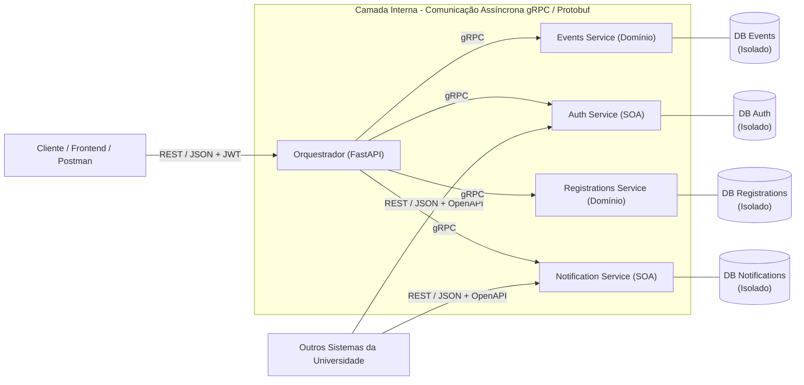

# 🎓 SGEA — Sistema de Gerenciamento de Eventos Acadêmicos

> Projeto desenvolvido como trabalho final da disciplina de **Arquitetura de Software**, combinando **Arquitetura Orientada a Serviços (SOA)** na camada corporativa/de borda com **Microsserviços orientados a domínio** e comunicação interna via **gRPC**.

---

## 📌 1. Contexto do Problema

Uma universidade necessita de uma plataforma centralizada para gerenciar eventos acadêmicos como **semanas acadêmicas, palestras e minicursos**. Para garantir reuso institucional, escalabilidade e independência evolutiva, a equipe de TI estabeleceu uma arquitetura híbrida que separa:

1. **Serviços Corporativos Reutilizáveis (SOA):** Serviços de caráter transversal com contrato formal (OpenAPI/Swagger), passíveis de consumo por outros sistemas da universidade (ex.: **Autenticação** e **Notificações**).
2. **Microsserviços de Domínio:** Serviços pequenos, coesos e desacoplados, com isolamento estrito de dados (*Database-per-Service*), responsáveis pelas regras específicas do negócio de eventos (ex.: **Eventos** e **Inscrições**).
3. **Camada de Orquestração e Borda:** Responsável por expor a API pública unificada (REST/JSON) e coordenar fluxos distribuídos entre múltiplos serviços (ex.: **Orquestrador**).

---

## 👥 2. Perfis de Usuário e Controle de Acesso (RBAC + JWT)

O controle de acesso é implementado via tokens **JWT (*JSON Web Tokens*)** contendo as *claims* de identidade e papel (*Role-Based Access Control* — RBAC). Todas as rotas protegidas validam o token e a permissão correspondente ao perfil antes de executar ou orquestrar qualquer ação.

| Perfil | Responsabilidades e Permissões |
| :--- | :--- |
| **Administrador** | Gerencia usuários, aprova ou rejeita eventos submetidos e visualiza relatórios gerais do sistema. |
| **Organizador** | Cria e edita seus próprios eventos, consulta a lista de inscritos e realiza o registro de presença dos participantes. |
| **Participante** | Consulta eventos disponíveis, realiza inscrição, cancela inscrição e emite certificado de participação. |

---

## 🏗️ 3. Arquitetura do Sistema

### Topologia de Serviços (Mínimo de 5 Serviços Independentes)

Cada serviço executa em seu próprio container/porta e possui responsabilidade única:

1. **`auth-service` (SOA / Borda):** Gestão de usuários, autenticação, emissão/validação de JWT e RBAC. Expõe contrato formal REST/OpenAPI para reuso por outros sistemas da universidade e interface gRPC para validação interna rápida.
2. **`notification-service` (SOA / Borda):** Serviço corporativo de disparo de notificações (confirmações de inscrição, avisos de eventos, certificados). Expõe contrato formal REST/OpenAPI e servidor gRPC para consumo interno.
3. **`events-service` (Microsserviço de Domínio):** Cadastro, edição, aprovação, consulta de eventos, controle de vagas e registro de presença. Banco de dados próprio.
4. **`registrations-service` (Microsserviço de Domínio):** Gestão de inscrições, cancelamentos, verificação de duplicidade e emissão de certificados. Banco de dados próprio.
5. **`orchestrator-service` (API Gateway / Orquestrador):** Ponto de entrada REST/JSON para o cliente do SGEA e coordenador de fluxos compostos via chamadas gRPC assíncronas.

### Diagrama Arquitetural



### Exemplo de Fluxo Orquestrado (Inscrição em Evento)

1. O **Participante** envia `POST /api/v1/inscricoes` ao **Orquestrador** portando seu token JWT.
2. O **Orquestrador** valida autenticação/papel RBAC e consulta o **Events Service** via **gRPC** para confirmar existência do evento, status aprovado e disponibilidade de vagas.
3. Estando válido, o **Orquestrador** aciona o **Registrations Service** via **gRPC** para persistir a inscrição no banco isolado (validando duplicidade).
4. Com a inscrição confirmada, o **Orquestrador** dispara de forma assíncrona o **Notification Service** via **gRPC** para registrar/enviar a notificação de confirmação.
5. O **Orquestrador** traduz a resposta gRPC e retorna HTTP `201 Created` ao cliente.

---

## ⚖️ 4. Decisões Arquiteturais (Requisitos Originais vs. Arquitetura Implementada)

Durante a concepção técnica do SGEA, optou-se por evoluir a stack e o protocolo de comunicação interna propostos inicialmente, mantendo integralmente os princípios arquiteturais exigidos (SOA + Microsserviços + Isolamento de Dados + RBAC), porém eliminando gargalos de performance e fragilidades de contrato.

### Quadro Comparativo

| Aspecto | Requisito Original | Arquitetura Atualizada (SGEA) |
| :--- | :--- | :--- |
| **Framework Web** | Python + **Flask** | Python + **FastAPI** |
| **Comunicação** | 100% **REST/JSON** (externa e interna) | **Híbrida:** REST/JSON na borda (SOA/Gateway) + **gRPC (Protobuf)** na comunicação interna |
| **Contratos Formais** | OpenAPI/Swagger via extensões (`flask-smorest` / `flasgger`) | **Duplo Contrato:** `.proto` (tipagem estrita interna) + **OpenAPI nativo** (FastAPI) na camada SOA/borda |
| **Orquestração** | Chamadas REST síncronas encadeadas | Chamadas **gRPC assíncronas** (`asyncio`) coordenadas pelo Orquestrador |
| **Banco de Dados** | SQLite isolado por serviço | **SQLite ou PostgreSQL isolado** por serviço (*Database-per-Service*) |
| **Padronização de Erros** | Verbos HTTP + Status Codes (`200, 201, 400, 401, 403, 404, 409`) | Status HTTP na borda + **mapeamento direto de Status Codes gRPC** internos |
| **Infraestrutura e Testes** | Docker Compose opcional; Postman ou `pytest` | **Docker Compose obrigatório** (subida com 1 comando) + **suíte `pytest`** (REST e gRPC) |

---

### Justificativa das Decisões (ADRs)

#### 🔹 ADR-001: Substituição de Flask por FastAPI
* **Motivação:** O Flask possui natureza síncrona (WSGI) por padrão e exige bibliotecas de terceiros (`flasgger`, `flask-smorest`, `marshmallow`) para gerar documentação OpenAPI e validar esquemas de entrada/saída.
* **Decisão:** Adotar **FastAPI** (ASGI) em todos os serviços de borda/SOA.
* **Benefícios:** Suporte nativo a `async/await` (essencial para um Orquestrador que aguarda múltiplas chamadas de rede sem bloquear threads), validação estrita via **Pydantic** e geração automática de contratos **OpenAPI/Swagger** sem código boilerplate.

#### 🔹 ADR-002: Arquitetura Híbrida de Comunicação (REST/JSON na Borda + gRPC/Protobuf Interno)
* **Motivação:** Em arquiteturas de microsserviços, a comunicação interna inteiramente baseada em REST/JSON adiciona sobrecarga de serialização textual, maior latência e ausência de contrato binário rígido entre serviços internos.
* **Decisão:** Manter **REST/JSON** exclusivamente na camada de exposição externa (Orquestrador/Gateway e interfaces SOA consumíveis por terceiros) e adotar **gRPC sobre HTTP/2 com Protocol Buffers (`.proto`)** para toda a comunicação interna entre microsserviços.
* **Benefícios:**
  1. **Alta Performance:** Serialização binária compacta e multiplexação de requisições via HTTP/2.
  2. **Contratos Estritos:** Os arquivos `.proto` atuam como fonte única de verdade (*Single Source of Truth*) entre produtores e consumidores internos, evitando quebras silenciosas de payload.
  3. **Compatibilidade SOA Preservada:** Sistemas externos da universidade continuam consumindo os serviços corporativos via REST/JSON documentado em OpenAPI, sem precisar implementar clientes gRPC.

#### 🔹 ADR-003: Mapeamento Semântico de Status Codes (gRPC ↔ HTTP)
* **Motivação:** Com a introdução do gRPC interno, erros de domínio precisam atravessar a fronteira interna e serem apresentados ao cliente REST seguindo rigorosamente a semântica HTTP exigida.
* **Decisão:** Implementar uma camada de tradução explícita no Orquestrador mapeando os `grpc.StatusCode` para os códigos HTTP da borda:

| Significado de Negócio / Erro | Status Code gRPC (Interno) | Status Code HTTP (Borda REST) |
| :--- | :--- | :--- |
| Sucesso em consulta / atualização / criação | `OK` | `200 OK` / `201 Created` |
| Dados inválidos ou regra de validação violada | `INVALID_ARGUMENT` | `400 Bad Request` |
| Token JWT ausente, inválido ou expirado | `UNAUTHENTICATED` | `401 Unauthorized` |
| Perfil RBAC sem permissão para a ação | `PERMISSION_DENIED` | `403 Forbidden` |
| Evento, usuário ou inscrição inexistente | `NOT_FOUND` | `404 Not Found` |
| Conflito (ex.: inscrição duplicada / evento lotado) | `ALREADY_EXISTS` / `FAILED_PRECONDITION` | `409 Conflict` |

#### 🔹 ADR-004: Isolamento Estrito de Dados (*Database-per-Service*)
* **Motivação:** Evitar acoplamento estrutural por banco de dados compartilhado, permitindo que cada microsserviço evolua seu esquema de forma autônoma.
* **Decisão:** Cada microsserviço possui seu próprio banco de dados (SQLite ou instância/schema PostgreSQL totalmente isolado). Nenhuma tabela é acessada diretamente por outro serviço; toda leitura ou escrita entre domínios ocorre exclusivamente via contrato gRPC.

#### 🔹 ADR-005: Containerização Unificada e Testes Automatizados (`pytest` + `uv`)
* **Motivação:** Ambientes distribuídos com 5+ serviços são propensos a erros de configuração manual e regressões entre contratos REST e gRPC.
* **Decisão:** Padronizar o gerenciamento de dependências Python com **`uv`**, orquestrar toda a topologia via **Docker Compose** (um único comando para subir toda a malha de serviços) e cobrir tanto as rotas REST/OpenAPI quanto os clientes/servidores gRPC com testes automatizados em **`pytest`**.

---

## 🛠️ 5. Stack Tecnológica

* **Linguagem:** Python 3.12+
* **Gerenciador de Pacotes/Ambiente:** `uv`
* **API / Borda SOA:** FastAPI + Uvicorn + Pydantic
* **Comunicação Interna:** gRPC (`grpcio`, `grpcio-tools`) + Protocol Buffers (`.proto`)
* **Autenticação / Segurança:** JWT (`PyJWT` / `python-jose`) + RBAC
* **Persistência:** SQLite / PostgreSQL (isolado por serviço)
* **Infraestrutura:** Docker & Docker Compose
* **Testes:** `pytest` (+ `pytest-asyncio`, `httpx`)

---

## 📂 6. Estrutura do Projeto

```text
.
├── docker-compose.yml        # Orquestração dos 5+ containers e redes internas
├── main.py                   # Ponto de entrada / utilitário local
├── pyproject.toml            # Dependências e configuração do projeto (uv)
├── uv.lock                   # Lockfile determinístico das dependências
├── README.md                 # Documentação arquitetural do SGEA
└── sgea/
    └── src/
        ├── protos/           # Contratos formais .proto e stubs gRPC gerados
        ├── auth_service/     # Serviço SOA de Autenticação e RBAC
        ├── notification_service/ # Serviço SOA de Notificações
        ├── events_service/   # Microsserviço de Domínio: Eventos
        ├── registrations_service/ # Microsserviço de Domínio: Inscrições
        └── orchestrator/     # Borda REST/OpenAPI e Orquestração gRPC
```

---

## 🚀 7. Como Executar e Testar

### Subindo todo o ambiente com Docker Compose (Recomendado)

```bash
# Clonar o repositório
git clone trabalho-final-arquitetura-software
cd trabalho-final-arquitetura-software

# Construir e iniciar todos os serviços em rede isolada
docker compose up --build
```

Após a inicialização, a documentação interativa **OpenAPI (Swagger UI)** dos serviços de borda/SOA estará disponível nas respectivas portas configuradas (ex.: `http://localhost:8000/docs` para o Orquestrador).

### Ambiente de Desenvolvimento Local com `uv`

```bash
# Instalar dependências reproduzíveis
uv sync

# Executar a suíte de testes automatizados (REST + gRPC)
uv run pytest -v
```
